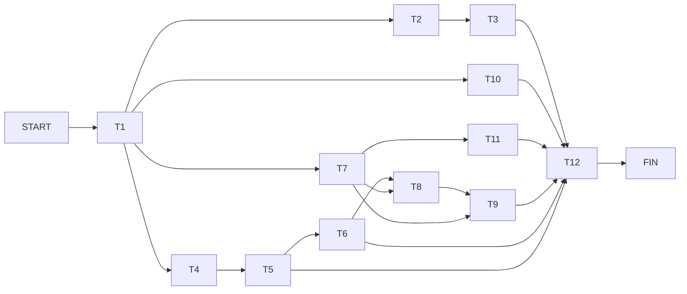
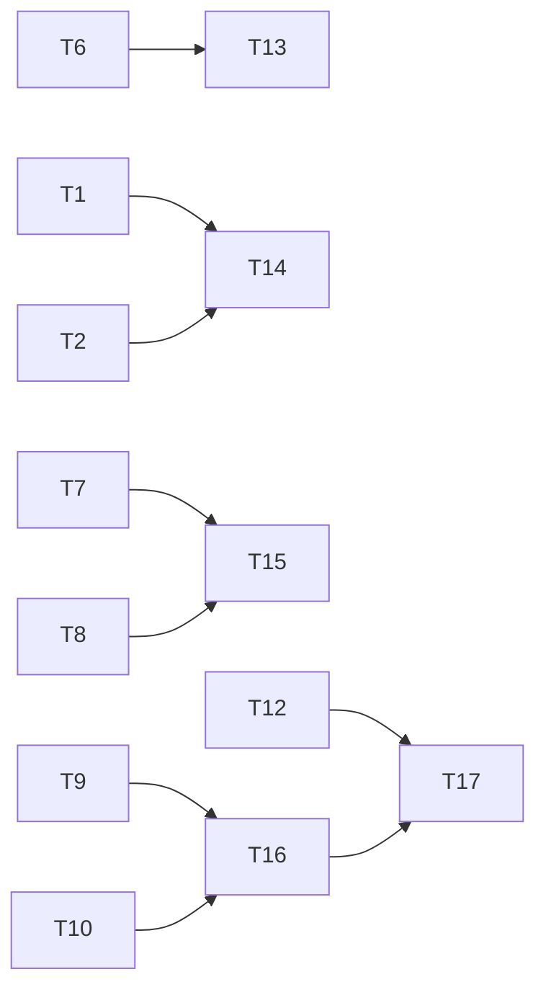

# PERT — Love Ink : Extensions Fonctionnelles

Basé sur le cahier des charges `docs/scope.md`.

---

## 1. Décomposition des tâches

| ID  | Tâche                                              | Dépendances   | to   | tm   | tp   | **te**  | σ    |
|-----|----------------------------------------------------|---------------|------|------|------|---------|------|
| T1  | Setup infra (schéma Firestore, rôles, règles)      | —             | 0.5j | 1j   | 2j   | **1.1j** | 0.25 |
| T2  | Messagerie — backend (collections, listeners)      | T1            | 1j   | 1.5j | 3j   | **1.7j** | 0.33 |
| T3  | Messagerie — UI (2 colonnes, chat temps réel)      | T2            | 1j   | 1.5j | 2.5j | **1.6j** | 0.25 |
| T4  | Notifications — logique backend compatible Spark (sans triggers Functions) | T1 | 0.5j | 1j | 2j | **1.1j** | 0.25 |
| T5  | Notifications — UI (cloche, badge, panneau)        | T4            | 0.5j | 0.5j | 1j   | **0.6j** | 0.08 |
| T6  | Refonte profil (onglets, URL hash)                 | T1, T5        | 1j   | 1.5j | 2.5j | **1.6j** | 0.25 |
| T7  | Modération — backend (statut histoires, workflow)  | T1            | 1j   | 1.5j | 3j   | **1.7j** | 0.33 |
| T8  | Modération — UI (interface modo, onglet profil)    | T6, T7        | 1j   | 1j   | 2j   | **1.2j** | 0.17 |
| T9  | Sanctions — backend + UI (censeurs)                | T7, T8        | 0.5j | 1j   | 2j   | **1.1j** | 0.25 |
| T10 | Candidature modérateur (formulaire + Firestore)    | T1            | 0.25j| 0.5j | 1j   | **0.5j** | 0.13 |
| T11 | Intégration feed.html / histoire.html (statuts)   | T7            | 0.25j| 0.5j | 1j   | **0.5j** | 0.13 |
| T12 | Tests intégration + corrections                    | T3,T5,T6,T8,T9,T10,T11 | 0.5j | 1j | 2j | **1.1j** | 0.25 |

> Formule PERT : **te = (to + 4·tm + tp) / 6**

---

## 2. Réseau de dépendances

### 2.1. Graphe principal (PERT initial T1 → T12)



### 2.2. Graphe extension scope complet (T13 → T17)



---

## 3. Tableau ES / EF / LS / LF / Marge

| ID  | te   | ES   | EF   | LS   | LF   | Marge libre | Critique ? |
|-----|------|------|------|------|------|-------------|------------|
| T1  | 1.1j | 0.0  | 1.1  | 0.0  | 1.1  | **0.0**     | ✅ OUI     |
| T2  | 1.7j | 1.1  | 2.8  | 3.4  | 5.1  | 2.3j        | non        |
| T3  | 1.6j | 2.8  | 4.4  | 5.1  | 6.7  | 2.3j        | non        |
| T4  | 1.1j | 1.1  | 2.2  | 1.1  | 2.2  | **0.0**     | ✅ OUI     |
| T5  | 0.6j | 2.2  | 2.8  | 2.2  | 2.8  | **0.0**     | ✅ OUI     |
| T6  | 1.6j | 2.8  | 4.4  | 2.8  | 4.4  | **0.0**     | ✅ OUI     |
| T7  | 1.7j | 1.1  | 2.8  | 2.8  | 4.4  | 1.7j        | non        |
| T8  | 1.2j | 4.4  | 5.6  | 4.4  | 5.6  | **0.0**     | ✅ OUI     |
| T9  | 1.1j | 5.6  | 6.7  | 5.6  | 6.7  | **0.0**     | ✅ OUI     |
| T10 | 0.5j | 1.1  | 1.6  | 6.2  | 6.7  | 5.1j        | non        |
| T11 | 0.5j | 2.8  | 3.3  | 6.2  | 6.7  | 3.4j        | non        |
| T12 | 1.1j | 6.7  | 7.8  | 6.7  | 7.8  | **0.0**     | ✅ OUI     |

---

## 4. Chemin critique

```
T1 → T4 → T5 → T6 → T8 → T9 → T12
```

**Durée critique : 7.7 jours** (1.1 + 1.1 + 0.6 + 1.6 + 1.2 + 1.1 + 1.1)

Ce chemin correspond au bloc **Notifications → Profil → Modération → Sanctions**.
Tout retard sur ces tâches retarde directement la livraison du projet.

---

## 5. Variance et intervalle de confiance

σ² du chemin critique :

| Tâche | σ²    |
|-------|-------|
| T1    | 0.063 |
| T4    | 0.063 |
| T5    | 0.007 |
| T6    | 0.063 |
| T8    | 0.028 |
| T9    | 0.063 |
| T12   | 0.063 |
| **Σ** | **0.350** |

σ total = √0.350 ≈ **0.59j**

| Probabilité | Fourchette              |
|-------------|-------------------------|
| 68%         | 7.1j — 8.3j             |
| 95%         | **6.5j — 8.9j**         |
| 99%         | 6.0j — 9.5j             |

---

## 6. Planning suggéré (en jours ouvrés)

```
Jour 1    │ T1 — Setup infra & schéma
Jour 2    │ T4 — Notifs backend  │  T2 — Messagerie backend (en parallèle)
Jour 3    │ T5 — Notifs UI       │  T2 suite / T7 — Modération backend
Jour 4    │ T6 — Refonte profil  │  T7 suite
Jour 5    │ T6 suite             │  T11 — Intégration feed/histoire
Jour 6    │ T8 — Modération UI   │  T3 — Messagerie UI  │  T10 — Candidature modo
Jour 7    │ T9 — Sanctions       │  T3 suite
Jour 8    │ T12 — Tests & corrections
```

**Livraison nominale : J8 (~8 jours ouvrés)**
Buffer recommandé : +1 jour → **livraison cible : J9**

---

## 7. Risques principaux

| Risque                                          | Tâche(s) | Impact              | Mitigation                                  |
|-------------------------------------------------|----------|---------------------|---------------------------------------------|
| Règles Firestore complexes pour les rôles       | T1       | Bloque toute la chaîne | Prototyper les règles en émulateur d'abord |
| Listeners temps réel → surcharge Firestore      | T2, T4   | Performance dégradée | Paginer + détacher les listeners inactifs   |
| Refonte profil en onglets plus longue que prévu | T6       | +1j sur chemin critique | Découper en livrables partiels            |
| Tests révèlent des bugs de concurrence (likes)  | T12      | +1-2j               | Tester sur émulateur Firebase en amont      |

---

## 8. Compléments de couverture Scope (sans élargir T1)

Le principe est conservé: **T1 reste strictement infra** (schéma/règles/rôles de base).  
Les éléments du scope non explicitement couverts par le PERT initial sont ajoutés en **nouvelles tâches dédiées**.

### 8.1. Éléments du scope manquants dans le PERT initial

| Référence scope | Élément manquant / sous-spécifié dans le PERT initial | Action |
|-----------------|---------------------------------------------------------|--------|
| §5.1 (Paramètres) | Avatar Storage, mot de passe, suppression compte, préférences e-mail, mode nuit | Ajouter une tâche dédiée profil avancé |
| §6.1 (Modération) | Edition par modo avant approbation + conservation original | Ajouter une tâche dédiée workflow éditorial |
| §7.2 + §2.4 | Interface admin/censeur (promotion, historique sanctions/logs) | Ajouter une tâche dédiée ops/admin |
| §9.3 | Gestion de présence en ligne (`enLigne`) | Ajouter une tâche dédiée présence |
| §11 | Documentation admin/règles/collections livrables | Ajouter une tâche dédiée doc de livraison |

### 8.2. Nouvelles tâches PERT proposées

| ID  | Tâche                                                                 | Dépendances   | to   | tm   | tp   | **te**  |
|-----|-----------------------------------------------------------------------|---------------|------|------|------|---------|
| T13 | Profil avancé (avatar, mdp, suppression compte, prefs e-mail, nuit)  | T6            | 0.5j | 1j   | 2j   | **1.1j** |
| T14 | Présence en ligne (`enLigne`, heartbeat/session, stratégie cleanup)   | T1, T2        | 0.25j| 0.5j | 1j   | **0.5j** |
| T15 | Modération éditoriale (édition pré-approbation + historique original) | T7, T8        | 0.5j | 1j   | 2j   | **1.1j** |
| T16 | Ops admin/censeur (promotion rôle, historique sanctions, logs)        | T9, T10       | 0.25j| 0.5j | 1.5j | **0.6j** |
| T17 | Documentation de livraison (schéma, règles, runbook admin)            | T12, T16      | 0.25j| 0.5j | 1j   | **0.5j** |

### 8.3. Impact planning (macro)

- Le PERT initial (T1→T12) reste valide pour le coeur fonctionnel.
- Pour couvrir 100% du scope, prévoir une extension de planning:
  - **+2.5 à +4 jours ouvrés** selon parallélisation (T13-T17).
- Ces tâches additionnelles n’impliquent pas de redéfinir T1.

---

## 9. Décision de cadrage

- **T1 est gardé tel quel** (infra uniquement).
- Les manques scope sont traités par **T13-T17**.
- La validation finale “scope complet” ne peut être prononcée qu’après **T12 + T13-T17**.
